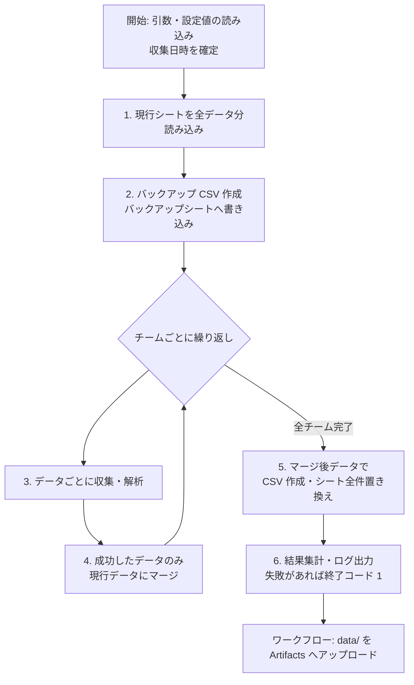
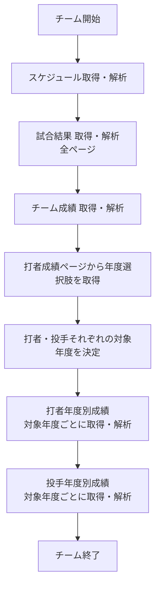

# 草野球データ収集ツール 機能設計書

| 項目 | 内容 |
| --- | --- |
| 版数 | 0.2 |
| 作成日 | 2026-10-26 |
| ステータス | 承認済（2026-10-26） |
| 前提文書 | [要件定義書](requirements.md) 0.4 |

## 1. 本書の位置づけ

本書は、要件定義書の各要件をどのような構成・ロジック・処理順序で実現するかを示す。関数名や引数の型などソースコードの粒度には立ち入らない。各節の見出しまたは本文に、対応する要件 ID（FR-xx / NFR-xx）を記す。

## 2. 全体構成

### 2.1 モジュール構成

NFR-10（収集・解析・保存の分離）に従い、以下のモジュールに分ける。

| モジュール | 責務 | 外部依存 |
| --- | --- | --- |
| CLI | 引数の解釈、設定値の読み込み、全体処理の呼び出し、終了コードの決定 | なし |
| 全体制御（Runner） | 処理フロー（3 章）の順序制御、チーム・データ単位の成否の集計 | なし |
| HTTP 取得（Fetcher） | teams への HTTP リクエスト。待機、再試行、User-Agent 付与 | requests |
| 解析（Parser） | HTML から行データ（レコードの一覧）を作る。データごとに 1 つ | BeautifulSoup |
| 収集（Collector） | URL の組み立て、ページ送り、対象年度の決定。Fetcher と Parser を組み合わせる | なし |
| マージ（Merger） | 現行データと収集結果を突き合わせ、置き換え後のデータを作る | なし |
| CSV 入出力 | CSV ファイルの書き出し | 標準ライブラリ |
| スプレッドシート入出力（SheetStore） | シートの読み込み、作成、全件置き換え | gspread、google-auth |

Parser はネットワークにもスプレッドシートにも依存しない。HTML 文字列を受け取り、行データを返すだけとする。これにより、ページ構造が変わったときの修正範囲が Parser に閉じ、保存済み HTML による単体テスト（NFR-11）が可能になる。

### 2.2 データ定義

5 種類のデータを、以下の属性を持つ「データ定義」として一か所にまとめる。Runner・Merger・SheetStore はこの定義を参照して動作し、データごとの分岐を持たない。

| 属性 | 内容 |
| --- | --- |
| データキー | `schedule` / `game_results` / `team_stats` / `batter_year_stats` / `pitcher_year_stats` |
| CSV ファイル名 | `{データキー}.csv` |
| バックアップファイル名 | `{データキー}.bk.csv` |
| シート名 / バックアップシート名 | 要件定義書 5.6・5.7 の表のとおり |
| 想定列 | 4.3 節で定義する列の並び |
| 年度別か | 打者・投手年度別成績のみ「はい」。マージ方法（5 章）が変わる |
| Parser / Collector | 当該データの解析・収集処理 |

### 2.3 ディレクトリ構成（案）

```
repo/
├── .github/workflows/collect.yml   # 週次・手動実行のワークフロー
├── src/ama_baseball/
│   ├── cli.py
│   ├── runner.py
│   ├── definitions.py              # データ定義（2.2 節）
│   ├── fetcher.py
│   ├── collectors.py
│   ├── parsers/                    # データごとの Parser
│   ├── merger.py
│   ├── csv_io.py
│   └── sheet_store.py
├── tests/
│   ├── fixtures/                   # 保存済み HTML
│   └── ...
├── data/                           # 実行時に作成（Git 管理外）
│   ├── *.csv
│   └── bks/*.bk.csv
└── docs/
```

## 3. 処理フロー

### 3.1 全体フロー

1 回の実行は以下の 6 段階で進む。段階 3〜4 だけがチームごとに繰り返され、それ以外は全チーム・全データをまとめて 1 回だけ行う。



| 段階 | 内容 | 対応要件 |
| --- | --- | --- |
| 開始 | 引数・設定値を読み込む。収集日時を実行開始時刻（JST）で 1 つ確定し、全レコードに共通で付与する | FR-01, FR-05, 5.3 |
| 1 | 5 つの現行シートを読み込み、メモリ上に「現行データ」として保持する。シートが無いデータは空として扱う | 4 章 |
| 2 | 現行データをバックアップ CSV とバックアップシートに書き出す | FR-50〜53 |
| 3 | 対象年度を決め、各ページを取得・解析する | FR-10〜14, FR-20〜23 |
| 4 | 収集に成功したデータだけを現行データにマージする。失敗したデータは現行データをそのまま残す | FR-32, FR-60 |
| 5 | マージ後のデータを CSV に書き出し、同じ内容で現行シートを全件置き換える | FR-30〜31, FR-40〜43 |
| 6 | 成否を集計してログに出し、終了コードを決める | FR-62, FR-63 |

マージ（段階 4）はメモリ上の現行データを更新するだけで、シートへの書き込みは段階 5 で 1 回にまとめる。チームを処理するたびにシートへ書き込む方式も考えられるが、書き込み回数が「チーム数 × 5」に増えて API 呼び出しの上限に近づくこと、途中で異常終了した場合に一部チームだけが反映されたシートが残ることから採らない。

### 3.2 1 チーム分の収集フロー



各データの取得・解析は独立して成否を判定する。あるデータが失敗しても、同じチームの後続データの処理は続ける。チーム単位の想定外の例外も捕捉し、次のチームへ進む（FR-61）。

年度選択肢の取得に失敗した場合は、対象年度が決まらないため、打者・投手年度別成績の両方を失敗とする。

## 4. 収集・解析

### 4.1 HTTP 取得（NFR-01〜04）

Fetcher はすべてのリクエストを 1 つのセッションで直列に送る。並列取得は行わない。

| 項目 | 設計 |
| --- | --- |
| リクエスト間隔 | 前回リクエストの完了から 1 秒以上空けてから次を送る。再試行時も同じ |
| User-Agent | `ama-baseball-collector/{バージョン} (+{リポジトリ URL})` の形式とする |
| タイムアウト | 接続・読み込みとも 30 秒 |
| 再試行対象 | タイムアウト、接続エラー、HTTP 5xx |
| 再試行回数・間隔 | 最大 3 回。待機は 5 秒 → 10 秒 → 20 秒と倍増させる |
| 再試行しないもの | HTTP 4xx（チーム ID 誤りなど、再試行しても結果が変わらないため）。即座に失敗とする |
| robots.txt | 起動時に 1 回取得し、各 URL が許可されているかを確認する。禁止されている URL は取得せず失敗とする。robots.txt 自体を取得できない場合は警告を出して続行する |

### 4.2 解析の共通方針

**HTML 構造の確認とデータ 0 件の区別**：各 Parser は、行を探す前に「そのページであることを示す要素」（一覧のコンテナ要素、表のヘッダ行など）の存在を確認する。存在しなければ解析失敗とする。存在して行が 0 件の場合は、正常な 0 件として扱う。この区別がないと、サイト改修で要素が見つからなくなったときに「データ 0 件」として既存行を消してしまう。

**表の列決定（NFR-12）**：表形式のページ（チーム成績・打者・投手）は、列の位置を固定せず、ヘッダ行のテキストから列名を決める。ヘッダテキストは空白と改行を除去して正規化する（例：`O<br>P<br>S` → `OPS`）。正規化したヘッダとデータ定義の想定列を比較し、差分があれば以下のように扱う。

| 差分 | 扱い |
| --- | --- |
| 想定外の列がある | 警告をログに出す。列はそのまま取り込み、想定列の後ろに追加する |
| 想定列が無い | 警告をログに出す。当該列は空欄とする |

列の増減はサイト改修の兆候だが、収集自体は継続できるため失敗にはしない。

**値の扱い**：セルの値は、前後の空白を除いた表示文字列をそのまま保持する（例：打率 `.500`）。数値への変換は行わない。セル内の hidden input などの付随要素は無視する。ただし、チーム成績の一部の列は例外とする（4.3.3 節）。

### 4.3 データ別の解析

列名はすべて日本語とし、`チーム`・`収集日時` 以外はサイトの表示に合わせる。すべてのデータで先頭 2 列を `チーム`、`収集日時` とする。`チーム` にはチーム ID、`収集日時` には収集日時（JST、ISO 8601 形式）を格納する。

#### 4.3.1 スケジュール（FR-10）

| 項目 | 内容 |
| --- | --- |
| 取得 URL | `/teams/{team}/plan` の 1 ページのみ |
| 行の単位 | 予定 1 件（予定一覧の各リンク要素） |
| 列 | `チーム`, `収集日時`, `日時`, `種別`, `タイトル`, `予定詳細ID` |

ページは「年・月の見出し」と「その月の予定一覧」が交互に並ぶ構造である。見出しを読むたびに現在の年・月を更新し、続く予定の「日」と組み合わせて `YYYY-MM-DD` を作る。

| 列 | 取り出し方 |
| --- | --- |
| 日時 | 直前の見出しの年・月 ＋ 予定の日（曜日部分は捨てる） |
| 種別 | 予定のラベル（練習試合など）のテキスト |
| タイトル | 予定のタイトル（活動日など）のテキスト |
| 予定詳細ID | リンク先 `/plan/{id}` の `{id}` |

#### 4.3.2 試合結果（FR-11）

| 項目 | 内容 |
| --- | --- |
| 取得 URL | `/teams/{team}/game?page={n}`（n = 1 から） |
| 行の単位 | 試合 1 件 |
| 列 | `チーム`, `収集日時`, `日時`, `試合属性`, `対戦チーム`, `スコア`, `サヨナラ`, `勝敗` |

**ページ送り**：1 ページ目を取得した後、ページ送り欄に「次へ」（`rel="next"`）のリンクがある間、次ページを取得する。ページ数の上限として 100 ページを設け、超えた場合は失敗とする（リンク構造の変化による無限ループを防ぐため）。ページ送り欄の件数表示（「全 47 件」など）が読み取れた場合は、取得件数と照合し、一致しなければ警告を出す。

| 列 | 取り出し方 |
| --- | --- |
| 日時 | `2026/10/11（日）` 形式の表示から曜日を除き、`2026-10-11` に変換する |
| 試合属性 | 対戦チーム欄のラベル（公式戦／練習試合／その他） |
| 対戦チーム | 対戦チーム欄からラベルを除いたテキスト |
| スコア | スコア表示から末尾の `x` を除いたもの（例：`6-9x` → `6-9`） |
| サヨナラ | スコア末尾に `x` があれば `TRUE`、なければ `FALSE` |
| 勝敗 | 勝敗ラベルのテキスト |

#### 4.3.3 チーム成績（FR-12）

| 項目 | 内容 |
| --- | --- |
| 取得 URL | `/teams/{team}/stats` |
| 行の単位 | 表の 1 行（年度別行と「通算」行） |
| 列 | `チーム`, `収集日時`, 以降はヘッダ行の列（年, 試合, 勝ち, …, 防御率） |

`年` 列は年度行では 4 桁の年、通算行では `通算` となる。両方をそのまま保持する。

以下のセルは HTML 上で空欄であり、サイトは JS で hidden input の値から計算して表示する。空欄のまま保存すると分析に使えないため、Parser でサイトの JS と同じ式で計算して値を埋める。セルに値が入っている場合は、表示文字列を優先する。

| 行 | 列 | 計算方法 |
| --- | --- | --- |
| 年度行 | 防御率 | 自責点 × `team_era_inning` × 3 ÷（投球回 × 3 ＋ 投球回の端数）。小数 2 桁。分母が 0 なら `ー` |
| 通算行 | 打率 | 全年度の安打の合計 ÷ 打数の合計。`.xxx` 形式（1 以上は `1.000` 形式）。どちらかが 0 なら `.000` |
| 通算行 | 本塁打・盗塁 | 全年度の合計 |
| 通算行 | 防御率 | 全年度の自責点・投球回・端数の合計で、年度行と同じ式により計算する |

自責点・投球回などは各年度行の hidden input（`earned_run_{年}`、`inning_{年}`、`part_of_inning_{年}`、`hit_{年}`、`at_bats_{年}`、`home_run_{年}`、`steal_{年}`）から、`team_era_inning` は防御率のヘッダセル内の hidden input から読み取る。`team_era_inning` が無い場合は解析失敗とする。

#### 4.3.4 打者・投手年度別成績（FR-13, FR-14）

| 項目 | 内容 |
| --- | --- |
| 取得 URL | CLAUDE.md 定義の `batters_table` / `pitchers_table` の URL に対象年度を埋め込んだもの |
| 行の単位 | 選手 1 人 |
| 列 | `チーム`, `収集日時`, `年度`, `背番号`, `選手名`, 以降はヘッダ行の列（試合数, 打率, …） |

表の先頭列は「背番号 選手名」が 1 セルにまとまっている（例：`13 もっちー`）。先頭の数字部分を `背番号`、残りを `選手名` に分割する。背番号が無い選手は `背番号` を空欄とする。`年度` は取得 URL に指定した年度を付与する（表中には年度が無いため）。

### 4.4 対象年度の決定（FR-20〜23）

対象年度は、チーム × データ（打者・投手）ごとに以下の手順で決める。取得可能年度の取得（手順 1）はチームごとに 1 回だけ行い、打者・投手で共有する。

1. 年度を指定せずに打者成績ページを取得し、年度選択欄（`search_result[game_date]`）の選択肢から、値が 4 桁の年であるものを集める。これを「取得可能年度」とする。
2. 以下の規則で対象年度を決める。当年度は実行開始時刻（JST）の暦年とする。

| 条件 | 対象年度 |
| --- | --- |
| 全年度再取得の引数あり（FR-23） | 取得可能年度のすべて |
| 現行データの当該シートに、当該チームの行が無い（FR-21） | 取得可能年度のすべて |
| 上記以外（FR-22） | 当年度。ただし取得可能年度に当年度が無ければ対象なし |

初回判定はシートごとに行う。打者シートには当該チームの行があり投手シートには無い、という場合は、打者は当年度のみ、投手は全年度を取得する。

対象年度が無い場合（当年度の試合がまだ無いなど）は、ページを取得せず「成功・0 年度」として扱い、既存行は変更しない。

## 5. マージ（FR-22, FR-32, FR-60）

### 5.1 置き換え範囲

収集に成功したデータについて、現行データから「置き換え範囲」の行を削除し、収集結果の行を追加する。置き換え範囲外の行（他チームの行、対象外年度の行）は手を加えない。

| データ | 置き換え範囲 |
| --- | --- |
| スケジュール | `チーム` が当該チームの全行 |
| 試合結果 | `チーム` が当該チームの全行 |
| チーム成績 | `チーム` が当該チームの全行 |
| 打者年度別成績 | `チーム` が当該チーム、かつ `年度` が今回の対象年度に含まれる行 |
| 投手年度別成績 | 同上 |

例：現行シートに orcas の 2022〜2026 年度と別チームの行があり、2026 年度だけを取得した場合、削除されるのは orcas の 2026 年度の行だけである。

年度別成績で、対象年度のうち 1 年度でも取得・解析に失敗した場合は、当該データ全体を失敗とし、どの年度も置き換えない。年度単位で部分的に反映すると、どの年度が古いままかを後から判別しにくくなるためである。試合結果のページ送りも同様に、1 ページでも失敗すれば全体を失敗とする。

### 5.2 列の統合

現行データと収集結果で列構成が異なる場合（サイト側の列の増減、4.2 節）は、両者の列の和集合を新しい列構成とする。並び順はデータ定義の想定列を先に、それ以外を出現順に後ろへ並べる。値の無いセルは空欄とする。

### 5.3 行の並び順

マージ後の行は以下の順に並べ替える。並び順を固定することで、実行ごとのシートの差分を追いやすくする。

| データ | 並び順 |
| --- | --- |
| スケジュール / 試合結果 | `日時` 昇順 → `チーム` 降順 |
| チーム成績 | `チーム` 昇順 → `年` 降順（通算行は各チームの末尾） |
| 打者 / 投手年度別成績 | `チーム` 昇順 → `年度` 降順 → `背番号` 昇順（数値として比較） |

## 6. 保存

### 6.1 現行シートの読み込み

SheetStore は保存先ブック（スプレッドシート ID は設定値、FR-44）を開き、5 つの現行シートを読み込む。1 行目をヘッダ、2 行目以降をデータとして、CSV と同じ「列名 → 値」の行データに変換する。

シートの値は書き込み時と同じく文字列として読み書きする（6.3 節）。これにより、シート → メモリ → CSV → シートと往復しても値が変わらない。

### 6.2 バックアップ（FR-50〜53）

| 手順 | 内容 |
| --- | --- |
| 1 | `data/bks/` を作成する |
| 2 | 現行シートが存在するデータについて、読み込んだ全件を `{データキー}.bk.csv` に書き出す |
| 3 | 同じ内容でバックアップシート（例：`スケジュール（バックアップ）`）を全件置き換える。シートが無ければ作成する |
| 4 | 現行シートが存在しないデータは、手順 2・3 を行わない（FR-53）。既存のバックアップシートにも手を加えない |

バックアップは収集（段階 3）より前に完了させる。バックアップの書き込みに失敗した場合は、その時点で処理全体を中止し、収集・現行シートの更新を行わない。バックアップが取れていない状態で現行シートを上書きすると、元に戻せなくなるためである。

### 6.3 CSV 作成とシート書き込み（FR-30〜31, FR-40〜43）

マージ後のデータごとに以下を行う。

1. `data/{データキー}.csv` を UTF-8（BOM なし）、1 行目ヘッダで書き出す。
2. 現行シートが無ければ作成する（FR-42）。
3. シートの内容を消去し、CSV と同じ内容（ヘッダ行＋全データ行）を一括で書き込む（FR-43）。

書き込みは入力値の自動解釈を行わないモード（Sheets API の `RAW`）を使う。自動解釈を行うと、`.500` が数値 0.5 に、`2026-10-11` が日付型に変換され、次回の読み込み値が CSV と一致しなくなるためである。分析時の型変換は分析側で行う。

全チームの収集がすべて失敗したデータでも、現行データ（＝バックアップと同じ内容）で書き込みを行う。内容は変わらないが、処理を分岐させないためである。

### 6.4 CSV の保管（FR-33）

CSV の Artifacts へのアップロードはプログラムではなくワークフローの手順で行う（7 章）。

## 7. 実行インタフェース

### 7.1 コマンドライン（FR-01, FR-02, FR-05, FR-23）

```
python -m ama_baseball --teams orcas,other_team [--all-years]
```

| 引数 | 必須 | 内容 |
| --- | --- | --- |
| `--teams` | 必須 | チーム ID。カンマ区切りで複数指定できる。前後の空白は除去し、重複は 1 つにまとめる |
| `--all-years` | 任意 | 指定時は全チームについて全年度を再取得する |

| 設定値（環境変数または `.env`） | 内容 |
| --- | --- |
| `SPREADSHEET_ID` | 保存先スプレッドシートの ID |
| `GOOGLE_APPLICATION_CREDENTIALS` | サービスアカウント鍵 JSON ファイルのパス |

設定値は、カレントディレクトリから親方向に探した `.env` ファイルから読み込む。同名の環境変数が設定済みの場合は環境変数を優先する（GitHub Actions では環境変数で与える）。`.env` は Git 管理外とし、項目の雛形を `.env.example` として置く。

ローカル実行でも同じ引数・設定値で同じ処理が動く。

| 終了コード | 意味 |
| --- | --- |
| 0 | 全チーム・全データが成功 |
| 1 | 1 件以上の失敗あり（FR-62）、またはバックアップ失敗等による中止 |
| 2 | 引数・設定値の誤り（処理開始前に終了） |

### 7.2 GitHub Actions ワークフロー（FR-03, FR-04, FR-33, NFR-20）

| 項目 | 設計 |
| --- | --- |
| トリガー | `schedule`（cron `59 14 * * 5`）と `workflow_dispatch` |
| 手動実行の入力 | `teams`（チーム ID、カンマ区切り、必須）、`all_years`（真偽値、既定 false） |
| スケジュール実行のチーム ID | リポジトリ変数 `TEAM_IDS` |
| 同時実行の制御 | `concurrency` で同一ワークフローの同時実行を禁止する。2 つの実行が同じシートを読み込み・上書きすると、一方の結果が消えるため |
| タイムアウト | ジョブに `timeout-minutes` を設定する（チーム数 × 10 分を目安、NFR-30） |

ジョブの手順は以下のとおり。

| 順 | 手順 | 備考 |
| --- | --- | --- |
| 1 | チェックアウト、Python セットアップ、依存ライブラリのインストール | |
| 2 | Secret `GOOGLE_SERVICE_ACCOUNT_JSON` の内容を一時ファイルに書き出し、パスを環境変数に設定 | 鍵の内容はログに出さない |
| 3 | 収集プログラムを実行 | チーム ID は手動実行時は入力値、スケジュール実行時は `TEAM_IDS` |
| 4 | `data/` 配下を Artifacts にアップロード | `if: always()` とし、手順 3 が失敗しても実行する。名前に実行日時を含める |

手順 3 の終了コードが 0 以外であれば、ジョブは失敗となり、GitHub 標準の通知が送られる（FR-62）。

## 8. エラー処理とログ

### 8.1 失敗の扱い（FR-60〜62）

失敗の単位は「チーム × データ」とする。Runner はこの単位で成否を記録し、最後に集計する。

| 発生箇所 | 扱い | 処理の継続 |
| --- | --- | --- |
| 引数・設定値の誤り | 終了コード 2 | 中止 |
| 現行シートの読み込み失敗 | 終了コード 1 | 中止（マージの基準が無いため） |
| バックアップの作成・書き込み失敗 | 終了コード 1 | 中止（6.2 節） |
| 取得失敗（再試行後）・解析失敗 | 当該チーム × データを失敗として記録し、既存行を維持 | 続行 |
| チーム処理中の想定外の例外 | 当該チームの未処理データをすべて失敗として記録 | 次のチームへ続行 |
| CSV・シートの書き込み失敗 | 当該データを失敗として記録 | 他データの書き込みは続行 |

### 8.2 ログ（FR-63）

標準出力にタイムスタンプ（JST）付きで出力する。GitHub Actions ではそのままジョブログになる。

| レベル | 出力内容 |
| --- | --- |
| INFO | 処理開始・終了、対象チーム、対象年度、取得 URL と HTTP ステータス、データごとの取得件数、マージ前後の件数、書き込み件数 |
| WARNING | 列の増減（NFR-12）、件数表示との不一致、再試行の発生、robots.txt の取得不可 |
| ERROR | 失敗したチーム × データとエラー内容（例外の種類とメッセージ） |

終了時に、チーム × データの成否を一覧で出力する。

```
[summary] orcas      schedule=OK(5) game_results=OK(47) team_stats=OK(6) batter_year_stats=OK(2026:14) pitcher_year_stats=NG(HTTP 503)
```

## 9. テスト方針（NFR-11）

| 対象 | 方法 |
| --- | --- |
| Parser | `tests/fixtures/` に保存した実ページの HTML を入力とし、行数と代表行の値を検証する。正常系に加え、0 件のページ、構造が変わったページ（コンテナ要素を削った HTML）、列が増減した表を用意する |
| 対象年度の決定 | 現行データ・取得可能年度・引数の組み合わせごとに、4.4 節の表どおりの結果になることを検証する |
| Merger | 5.1 節の置き換え範囲、失敗時の既存行維持、列の統合、並び順を検証する |
| Collector | Fetcher を差し替え、ページ送りの終了条件と上限、年度ごとの URL 組み立てを検証する |
| Fetcher | HTTP をモックし、再試行対象・回数・間隔、4xx で再試行しないことを検証する |

SheetStore は外部 API に依存するため単体テストの対象外とし、テスト用スプレッドシートを使った手動確認で代える。

## 10. 要件対応表

| 要件 | 本書の該当箇所 |
| --- | --- |
| FR-01, 02, 05 | 7.1 |
| FR-03, 04 | 7.2 |
| FR-10〜14 | 4.3 |
| FR-20〜23 | 4.4 |
| FR-30〜32 | 5, 6.3 |
| FR-33 | 7.2 |
| FR-40〜44 | 6.1, 6.3 |
| FR-50〜53 | 6.2 |
| FR-60〜62 | 3.2, 5.1, 8.1 |
| FR-63 | 8.2 |
| NFR-01〜04 | 4.1 |
| NFR-10 | 2.1 |
| NFR-11 | 9 |
| NFR-12 | 4.2 |
| NFR-20 | 7.1, 7.2 |
| NFR-21 | 運用（スプレッドシートの共有設定）で対応。本プログラムの機能では扱わない |
| NFR-30 | 7.2 |
